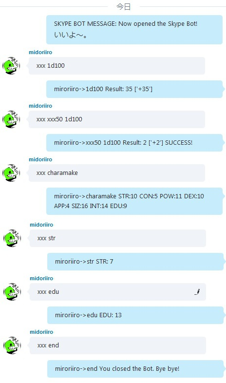
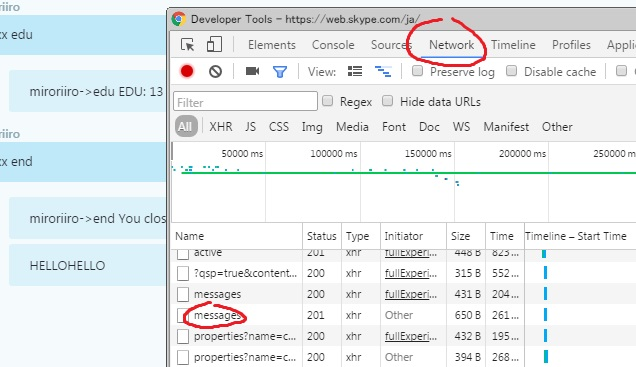
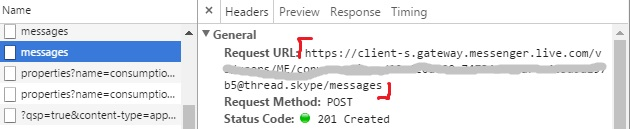
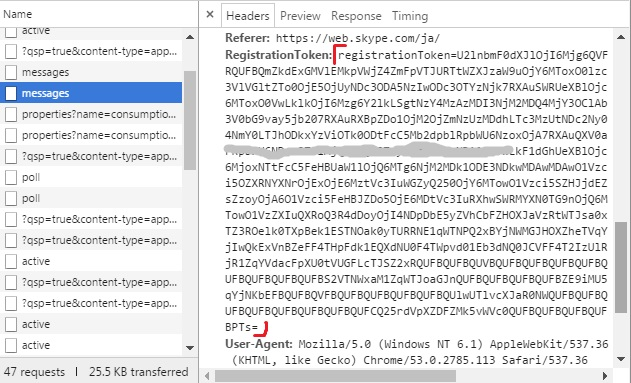

CocSkypeBot
===

CoC (クトゥルフ神話 TRPG) のセッションを支援する Skype 用のダイス bot です。
「`xxx 1d100`」のような発言に、ダイスロールやキャラクター作成の結果を返します。



## 現在の状況 (Skype の提供終了について)

- Skype (個人向け) は 2025-05-05 に提供を終了し、Microsoft Teams (無料版) へ移行しました
  ([Microsoft サポート](https://support.microsoft.com/en-us/skype/skype-is-retiring-in-may-2025-what-you-need-to-know-2a7d2501-427f-485e-8be0-2068a9f90472))。
- この bot が利用していた次の 2 つは、現在は利用できません。実サービスとの連携 (`run`) は動作を確認していません。
  - Skype classic デスクトップ版のローカル DB (`main.db`)
  - Skype for Web の非公式なメッセージ送信 API
- ダイスロールとキャラクター作成の機能は、Skype なしでローカルで実行できます (`console` / `demo`)。
  `demo` では合成した `main.db` を使い、本来の「DB の監視 → 発言の取得 → 返答」の流れをそのまま実行します。

## クイックスタート (Docker)

Docker だけで、ビルドから動作確認まで行えます。実行時にネットワークは使いません。

```sh
docker build -t coc-skype-bot:local .

# demo: 合成した main.db に発言を書き込み、bot の返答を表示します。
docker run --rm --network none coc-skype-bot:local demo --seed 1

# demo: 合成イベントファイルを標準入力から渡します。
docker run --rm -i --network none coc-skype-bot:local demo --events - --seed 1 < examples/demo-events.txt

# console: 標準入力の 1 行を 1 発言として扱います。
printf 'xxx 1d100\nxxx charamake\nxxx end\n' | docker run --rm -i --network none coc-skype-bot:local console

# console を対話的に使う場合です (xxx end または Ctrl-D で終了します)。
docker run --rm -it --network none coc-skype-bot:local console
```

`demo` の出力例です (`--seed` を指定すると、同じ結果を再現できます)。

```text
SKYPE BOT MESSAGE: Now opened the Skype Bot!
> alice: xxx 1d100
alice->1d100 Result: 18 ['+18']
> bob: good evening, everyone
> bob: xxx 2d4 -1d4
bob->2d4 -1d4 Result: 3 ['+4', '-1']
...
> alice: xxx end
alice->end You closed the Bot. Bye bye!
```

## ローカル (Python) での実行

Python 3.11 以上が必要です。

```sh
python -m venv .venv
. .venv/bin/activate
pip install .

coc-skype-bot demo --seed 1
coc-skype-bot console
```

## 使い方

「`xxx [コマンド]`」の形式で発言します。`xxx` の部分は設定 (`key`) で変更できます。

| コマンド | 内容 |
|---|---|
| `1d100` / `2d4 -1d4` / `1d6 3` / `10 -1` | ダイスロールです。ダイスと定数を空白区切りで加減算します |
| `xxx50 1d100` | 目標値判定です。合計が目標値 (この例では 50) 以下なら `SUCCESS!` を返します |
| `charamake` | CoC (6 版) の能力値 (STR CON POW DEX APP SIZ INT EDU) をまとめて作成します |
| `str` `con` `pow` `dex` `app` `siz` `int` `edu` | 能力値を 1 つだけ振ります |
| `help` | ヘルプを表示します |
| `end` | bot を終了します |

コマンドの大文字小文字は区別しません。ダイスの個数・面数は 1〜9999 の範囲で指定してください。

## 動作モード

| サブコマンド | 入力 | 出力 |
|---|---|---|
| `console` | 標準入力 (1 行 = 1 発言) | 標準出力 |
| `demo` | 合成イベント (`--events` で指定。省略時は組み込みのイベント) を合成した `main.db` へ書き込みます | 標準出力 |
| `run` | Skype classic の `main.db` | Skype for Web (`--dry-run` を指定すると標準出力) |

いずれのサブコマンドでも、`--seed` で乱数を固定できます。

## 旧 Skype 連携 (`run`) の設定 (参考情報)

Skype が提供されていた当時の手順です。現在は Skype が終了しているため、この手順は利用できません。

初回は `SkypeBot.conf.default` を `SkypeBot.conf` という名前でコピーし、値を設定します。
`SkypeBot.conf` にはトークンを記載するため、Git の管理対象外にしています。

```sh
coc-skype-bot run --config SkypeBot.conf            # Skype for Web へ返答します
coc-skype-bot run --config SkypeBot.conf --dry-run  # 返答を標準出力へ書き出します
```

### dbPath

Skype classic デスクトップ版のプロフィールのディレクトリです (この中に `main.db` があります)。

    Windows - C:/Users/username/AppData/Roaming/Skype/skypeId
    Mac     - /Users/username/Library/Application Support/Skype/skypeId

### roomId

bot を反応させる会話の `convo_id` (`main.db` の Messages テーブルの値) です。空欄の場合は、すべての会話に反応します。

### key

bot を呼び出す接頭辞です。`xxx` と設定すると、「`xxx 1d100`」のように使います。

### url

Chrome で Skype for Web を開き、F12 キーで Developer Tools を開きます。Network タブを開いた状態で、
bot を使いたいチャットに何か発言すると、Message という項目が 2 つ表示されます。画像の赤い印の項目を選びます。



Request URL の値を `url` に設定します (https の URL のみ受け付けます)。



### token

Request URL から下へスクロールし、RegistrationToken の値を `token` に設定します。



## 開発

```sh
pip install -e . --group dev
ruff check .
ruff format --check .
mypy
pytest
```

テストでは、合成した `main.db` と HTTP のモックだけを使います。実際の Skype へは接続しません。
GitHub Actions では、Python 3.11〜3.15 での lint・型チェック・テストと、Docker イメージの build と `demo` / `console` の実行を確認しています。

| モジュール | 役割 |
|---|---|
| `coc_skype_bot/dice.py` | ダイス式の計算と能力値の作成 |
| `coc_skype_bot/replies.py` | 発言から返答文を作成 |
| `coc_skype_bot/bot.py` | 発言の取得・返答・送信と、`main.db` の監視 |
| `coc_skype_bot/skype.py` | 旧 Skype (`main.db` / Skype for Web) との送受信 |
| `coc_skype_bot/local.py` | `console` / `demo` (Skype を使わないローカル実行) |
| `coc_skype_bot/config.py` | `SkypeBot.conf` の読み込み |
| `coc_skype_bot/cli.py` | コマンドラインのエントリポイント |
